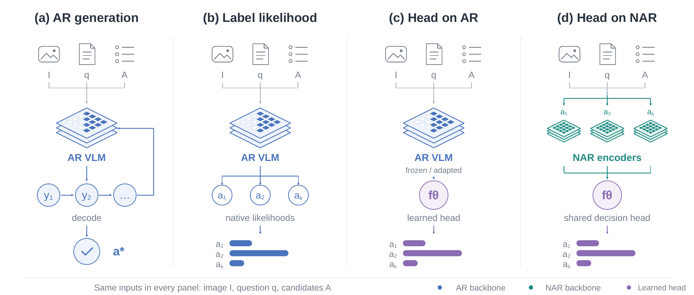
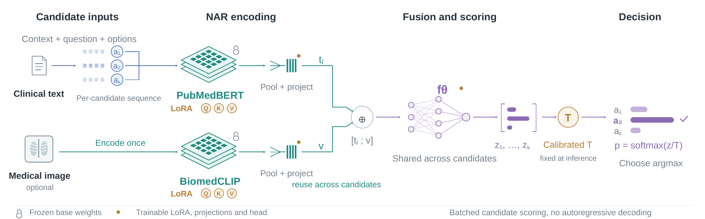
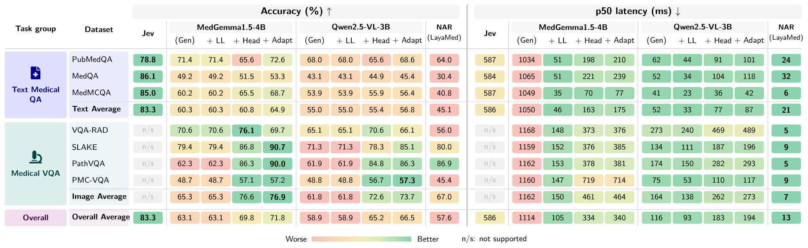

# SysOne-Med

**System One for medical decisions.** This project dissects how direct decision
models like **Jev** work by breaking the decision down into its constituent
formulations and rebuilding it, step by step, on a single medical backbone
(**MedGemma**) — from slow autoregressive writing all the way to a single
non-autoregressive scoring pass.

Given the same clinical question and the same answer choices, *how* a model turns
that input into a decision changes both its **accuracy** and its **latency**. We
reproduce each decision formulation on **MedGemma** (plus the hosted **Jev**
baseline and the **LayaMed** non-autoregressive model) across seven medical
datasets, and report accuracy, calibration, and p50 decision latency.

> ### 🚀 Try it yourself
> **<https://razaimam45.github.io/sysone-med/>** — explore the decision paths on real SLAKE /
> MedQA cases in the **Medical VQA** observatory, or race them side by side in the
> **Snake race**. No install, no GPU — it replays saved measurements.

---

## The decision formulations

A **decision model** answers a multiple-choice question by assigning a score to each
candidate and picking the best — without necessarily *writing* an answer. This project
dissects that idea by starting from the most familiar way a language model answers
(free-text generation) and progressively removing the autoregressive machinery, until
the decision is a single direct scoring pass. Every formulation below is run on the
**same inputs** (image `I`, question `q`, candidates `A`) and the **same held-out
rows**, so the only thing that changes is *how the decision is made*.



| Method | Full form | What it does | Script |
| --- | --- | --- | --- |
| **Jev** | Jev (hosted decision API) | A hosted model that scores the candidates directly — the reference "direct decision" system we dissect. | `baselines/run_jev.py` |
| **AR-Gen** | Autoregressive · Generative | MedGemma writes free text (up to 32 tokens), one token at a time; the text is parsed into a choice. The slowest, most familiar path. | `baselines/run_ar.py` |
| **AR-LL** | Autoregressive · Label Likelihood | The same MedGemma emits exactly one token; its probability is the choice score. Drops the multi-token writing. | `baselines/run_ll.py` |
| **AR-Head** | Autoregressive backbone · Decision Head | A frozen MedGemma backbone feeds a small trained head that scores every option at once — no tokens are written. | `baselines/run_direct_headonly.py` |
| **AR-Adapt** | Autoregressive backbone · Decision Head + LoRA | AR-Head plus low-rank (LoRA) adapters that adapt the frozen backbone to the decision task. | `baselines/run_direct_lora.py` |
| **NAR** | Non-Autoregressive (LayaMed) | Text and image are encoded once and a shared head scores all candidates in a single forward pass — no autoregressive decoding at all. | `baselines/run_laya_med.py` |

**The progression.** Reading left to right, each step removes more of the
autoregressive "write-then-parse" machinery:

- **AR-Gen → AR-LL:** stop writing a full answer; read the decision off a single token.
- **AR-LL → AR-Head:** stop generating tokens entirely; score the options with a learned head on a frozen backbone.
- **AR-Head → AR-Adapt:** keep the head, but adapt the backbone with LoRA so it helps the decision.
- **AR-Adapt → NAR:** drop the autoregressive backbone altogether — encode once, score all candidates in one pass.

The **NAR** path encodes text and image once (PubMedBERT + BiomedCLIP, LoRA-adapted),
fuses them, and scores all candidates with a shared, calibrated decision head —
batched candidate scoring, no autoregressive decoding.



## Results

Held-out accuracy and p50 decision latency across the seven datasets. **Upper-left
is better** — direct scoring stays accurate without the generation cost.



---

## Datasets

Seven closed-choice medical datasets — three text, four image:

| Task group | Datasets |
| --- | --- |
| **Text Medical QA** | `pubmedqa`, `med_qa`, `medmcqa` |
| **Medical VQA** | `vqarad`, `slake`, `path_vqa`, `pmc_vqa` |

All methods read a single **audited manifest** (`data/prepared/manifest.json`) so
every formulation is scored on the *same* held-out rows. To use your own data, place
it in the layout below and re-prepare the manifest:

```text
data/
  sources/
    pubmedqa/            ori_pqal.json, test_ground_truth.json
    vqarad/              annotations.json, images/
  normalized/            one folder per dataset, each with split JSONL
    med_qa/              train.jsonl, test.jsonl, validation.jsonl, calibration.jsonl
    medmcqa/
    slake/
    path_vqa/
    pmc_vqa/
  prepared/              generated: manifest.json + train/validation/calibration/test.jsonl
  models/                text + vision encoder snapshots (symlinks)
```

Each `normalized/<dataset>/` split is a JSONL of decision rows
(`question`, `options`, `label`, and `state.image` for image tasks). Point the
preparer at your data with `--medical-data-dir` and `--datasets`:

```bash
python training/prepare_data.py \
    --medical-data-dir data/normalized \
    --datasets med_qa medmcqa slake path_vqa pmc_vqa \
    --output-dir data/prepared
```

## Setup

The scripts import `med_jevify` directly from `src/` (no install step), so you only
need the dependencies in a Python environment:

```bash
# 1. Environment
conda create -n ttw python=3.11 -y && conda activate ttw
pip install "torch>=2.2" "transformers==5.17.0" "datasets>=2.18" "accelerate>=0.30" \
            "huggingface_hub>=0.24" "peft>=0.14" "numpy>=1.24" "pandas>=2.0" \
            "scikit-learn>=1.3" "Pillow>=9.5" "open_clip_torch" "laya>=0.3.20" \
            "jevify @ git+https://github.com/kushalpatil07/jevify.git@66f49bff53b3276fecc6b4bd16a31de277bebfaf"

# 2. Download the text + vision encoders (and optional HF datasets)
python training/download_assets.py --all-medical

# 3. Prepare the audited manifest (see "Datasets")
python training/prepare_data.py --output-dir data/prepared
```

## Run the methods

Each script scores the held-out rows and writes `results/<method>/` (JSON + CSV +
Markdown report). `--max-samples` caps rows per task; `--tasks` selects a subset.

```bash
# Jev (hosted API, text tasks) — needs an OpenRouter key
export OPENROUTER_API_KEY=<your-key>
python baselines/run_jev.py --tasks pubmedqa med_qa medmcqa --max-samples 1000 --append

# AR-Gen / AR-LL (MedGemma autoregressive)
python baselines/run_ar.py  --tasks pubmedqa med_qa medmcqa vqarad slake path_vqa pmc_vqa --max-samples 1000
python baselines/run_ll.py  --tasks pubmedqa med_qa medmcqa vqarad slake path_vqa pmc_vqa --max-samples 1000

# AR-Head / AR-Adapt (MedGemma frozen backbone + decision head [+ LoRA])
python baselines/run_direct_headonly.py --run models/medgemma-direct-headonly --max-samples 1000
python baselines/run_direct_lora.py     --run models/medgemma-direct          --max-samples 1000

# NAR (LayaMed multimodal non-autoregressive)
python baselines/run_laya_med.py --run models/laya-med --max-samples 1000 --append
```

Or run all of them at once:

```bash
bash scripts/run_all.sh
```

The `--run` flag points at a trained checkpoint (head-only, LoRA, or NAR). Train
your own with `training/train_medgemma_direct.py` (AR-Head / AR-Adapt) and
`training/train.py` (NAR / LayaMed) — see `training/README.md`.

## Repository layout

```text
baselines/            one script per decision formulation (the 6 methods above)
src/med_jevify/       adapters, evaluation, metrics, calibration, task loaders
training/             data prep, model download, training + evaluation
scripts/run_all.sh    run all five formulations end to end
tests/                unit tests for the evaluation pipeline
docs/                 figures used in this README
```

## Notes

- Everything is **reproducible from the manifest** — no live GPU is needed to read
  the recorded results, but running the methods requires the models above.
- Large data and model weights (`data/`, `models/`) are git-ignored; download them
  with `training/download_assets.py`.
