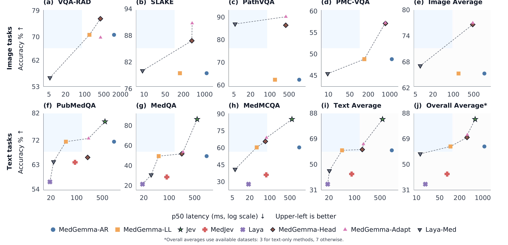

# SysOne-Med

**System One for medical decisions.** A study of how medical vision-language models
reach a multiple-choice answer — and a live demo that lets you *try* five decision
paths side by side.

> ### 🚀 Try it yourself
> **<https://sysone-med.github.io>** — step through real SLAKE / MedQA cases in the
> **Medical VQA** observatory, or pit all five variants against each other in the
> **Snake race**. No install, no GPU — everything replays saved measurements.

---

## The question

Given the same clinical question and the same answer choices, *how* a model turns
that input into a decision changes both its **accuracy** and its **latency**. We
compare five decision formulations on the same inputs:

| Variant | Decision mechanism |
| --- | --- |
| **AR Gen** | Autoregressive — writes free text (up to 32 tokens), then parses it into a choice |
| **AR LL** | Autoregressive — emits exactly one token (the fastest AR path) |
| **AR Head** | Frozen MedGemma backbone + a small learned head that scores every option at once |
| **NAR** | Non-autoregressive — encodes text + image once, a shared head scores all candidates in one pass |
| **MedJev** | A compact causal LM that scores the candidate set directly (text-only) |

## Four decision formulations

The same inputs (image `I`, question `q`, candidates `A`) in every panel — only the
decision interface changes.


## The NAR direct-decision architecture

Text and image are encoded once (PubMedBERT + BiomedCLIP, LoRA-adapted), fused, and
scored by a **shared decision head** with a calibrated temperature — batched candidate
scoring, no autoregressive decoding.


## Accuracy vs. latency

Held-out accuracy against p50 decision latency across seven image and text tasks.
**Upper-left is better** — direct scoring stays accurate without the generation cost.



---

## The demo

The site is a small, dependency-free web app (Python standard library only). It has
three pages:

| Page | What it is |
| --- | --- |
| **Home** | A briefing on the study: the five decision paths, real per-variant latency/accuracy, and the paper's figures. |
| **Medical VQA / QA** | The full inference observatory — step through held-out SLAKE (visual) and MedQA (text) cases; each variant's prediction, confidence, and latency, plus a throughput race. |
| **Snake race** | Five snakes in one arena on a shared clock. Each snake makes a move per decision and a decision costs that variant's *measured mean latency*, so the fastest path visibly outruns the slowest. |

### Run it locally

```bash
python demo2/server.py            # → http://localhost:8766
```

Requires `demo/data/comparison.json` (the recorded predictions). If it's missing, run
the original demo once to build it: `python demo/server.py`.

### Build the static site (GitHub Pages)

GitHub Pages can't run the server, so `demo2/build_pages.py` produces a self-contained
static copy in `demo2/site/` (precomputed JSON + relative paths):

```bash
python demo2/build_pages.py       # → demo2/site/  (~14 MB)
```

The published site lives on the `gh-pages` branch.

## Repository layout

```
demo2/            # the site: briefing + snake race + VQA (server.py, build_pages.py)
demo/             # the recorded-inference VQA/QA observatory (reused by demo2)
Jevify/paper/     # the LaTeX paper + figure PDFs
results/          # recorded predictions per variant
experiment_results/
src/med_jevify/   # adapters + evaluation code
tests/
```

## Notes

- Everything replays **saved measurements** — no live inference, GPU, or API key.
- Large data and model weights (`data/`, `models/`, `tta_results/`) are git-ignored.
